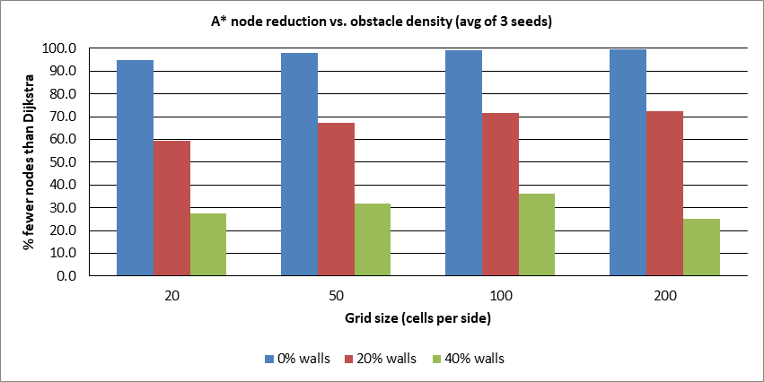
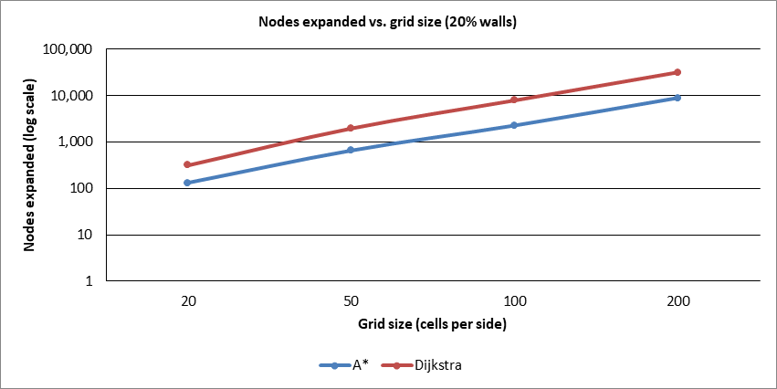
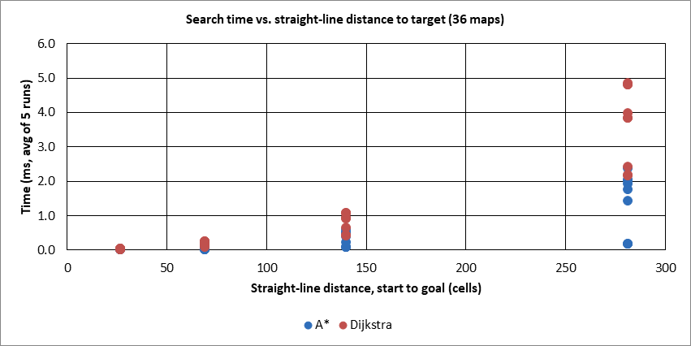

# A* vs. Dijkstra: Grid Map Generation & Benchmarking (C++)

How much faster is A* search than Dijkstra's algorithm, and on which kinds of maps does that change? This project answers it experimentally: a generator builds 36 reproducible grid maps of controlled size and obstacle density, and a benchmarking harness runs both algorithms on every map and measures their cost.

Built for the CS 3358 (Data Structures & Algorithms) Honors Credit project at Texas State University, Fall 2026, by **Brian Duke** (map generation, benchmarking and analysis) and **Siam Ahmed** (A* and Dijkstra implementation).

[](https://youtu.be/A8KaqjbGgT0)

**[Watch the 11-minute walkthrough](https://youtu.be/A8KaqjbGgT0)**: the generator and benchmark running live, and what the results show.

## Key findings



- **A* and Dijkstra found the same shortest path on all 36 maps.**
- **On open grids, A* expands 95–99.5% fewer nodes.** On a 200×200 grid it expands 200 nodes; Dijkstra expands all 40,000.
- **Obstacles erode the advantage:** about 68% fewer nodes with 20% walls, and about 30% fewer with 40% walls. The straight-line heuristic gets less accurate as walls force detours.
- **With dense obstacles, A* can be slower than Dijkstra** even while expanding fewer nodes. Each A* step costs more (it computes a heuristic), and when the node saving drops to around 10%, that extra cost wins.
- **Only about 1.9% of random maps with 40% walls had any path between the corners.** That density sits close to the grid's *percolation threshold*, where open cells stop connecting across the map, so the generator retries until it finds a solvable map.
- **Dijkstra's cost per expanded node grew from about 95 to 120 ns** as the map grew 100×, which is consistent with its O(V log V) bound.

| Obstacle density | A* node reduction (average of all sizes) | Range across maps |
|---|---|---|
| 0% | 97.9% | 95.0–99.5% |
| 20% | 67.6% | 48.8–78.7% |
| 40% | 30.2% | 10.0–62.6% |

## How it works

```
MazeGen  ──>  maps/gen/*.txt  ──>  Benchmark  ──>  benchmark.csv  ──>  Excel charts
 (36 maps)                       (runs A* and Dijkstra
                                  from Common/Astar.h)
```

**Shared graph model ([`Common/Grid.h`](Common/Grid.h)).** Every program uses one header, so the generator, the searches and the benchmark all see the same graph.
- Each map is stored as one flat array of cells, so a cell's array index is its node ID (`y * width + x`). No adjacency list is stored; neighbors are generated on demand.
- Movement is 8-directional: straight steps cost 1 and diagonal steps cost √2. A diagonal step may cut past one wall's corner, but may not squeeze between two walls that touch at their corners.
- The A* heuristic is the straight-line (Euclidean) distance to the goal. It never overestimates under these movement rules, so A* stays correct.

**Map generator ([`MazeGen/MazeGen.cpp`](MazeGen/MazeGen.cpp)).**
- It builds a full factorial design: 4 sizes (20, 50, 100, 200) × 3 obstacle densities (0%, 20%, 40%) × 3 seeds, for 36 maps.
- Every cell becomes a wall with probability equal to the density. The start (top-left) and goal (bottom-right) are always open.
- A breadth-first search checks that the goal is reachable. If it isn't, the map is discarded and regenerated.
- Each map comes from a seeded Mersenne Twister, so it can be reproduced exactly. The seed, density and number of attempts are recorded in the file.

**Benchmark harness ([`Benchmark/Benchmark.cpp`](Benchmark/Benchmark.cpp)).**
- It runs A* and Dijkstra on every map, timing each search 5 times and averaging.
- It checks that both distances match within a small tolerance.
- It writes 13 columns per map to `benchmark.csv`, including nodes expanded, % reduction and time.

**Search ([`Common/Astar.h`](Common/Astar.h), by Siam Ahmed).** A* and Dijkstra share one search function. Dijkstra simply uses a heuristic of 0, so the comparison measures the heuristic alone and not differences between two implementations. It uses a binary-heap priority queue with lazy deletion, and breaks ties toward the goal.

## More results

| Nodes expanded vs. grid size (20% walls) | Search time vs. distance to goal |
|---|---|
|  |  |

Full per-map results are in [`Benchmark/benchmark.csv`](Benchmark/benchmark.csv), and the summary tables and charts are in [`Benchmark/benchmark_charts.xlsx`](Benchmark/benchmark_charts.xlsx).

## Build and run

Requirements: Windows with **Visual Studio 2026** (Community is fine) and the *Desktop development with C++* workload. The projects build as C++20. The solution uses the newer `.slnx` format, which older Visual Studio versions may not open.

1. Clone the repository and open **`Benchmark.slnx`**.
2. Set the configuration to **Release** and **x64**. Debug builds give the same node counts, but times are 14–26× slower.
3. **Generate the maps:** right-click **MazeGen → Set as Startup Project**, then press **Ctrl+F5**. This writes 36 maps to `maps/gen/`. The same seeds always produce the same maps.
4. **Run the benchmark:** set **Benchmark** as the startup project and press **Ctrl+F5**. It prints a results table and writes `Benchmark/benchmark.csv`.
5. **Run the A* demo (optional):** set **Pathfinding** as the startup project. It runs the sample maze and the required 100×100 test.

Map file format, if you want to make your own:

```
; optional comment lines start with a semicolon
GRID <width> <height>
START <x> <y>
GOAL <x> <y>
<height rows of <width> characters: '.' open, '#' wall>
```

## Repository layout

```
Benchmark.slnx            Visual Studio solution (three console apps)
Common/Grid.h             shared grid model, map loader/saver, neighbor rule, heuristic
Common/Astar.h            A* and Dijkstra (Siam Ahmed)
MazeGen/                  map generator (Brian Duke)
Benchmark/                benchmarking harness, results CSV, charts (Brian Duke)
Pathfinding/              A* demo driver and required 100x100 test (Siam Ahmed)
maps/                     hand-made sample maps
maps/gen/                 the 36 generated benchmark maps
```

## Limitations and next steps

- The start and goal are always opposite corners, so distance to the goal and grid size change together. The next step is to vary the goal position on a fixed map.
- Three seeds per configuration show the trends, but not tight confidence intervals.
- Module 1D's second dataset (random directed graphs with negative weights) and the Johnson's vs. Floyd-Warshall benchmark are still to come.

## Credits

- **Brian Duke:** map generator, benchmarking harness, experiment design, charts and analysis, shared header and repository setup.
- **Siam Ahmed:** A* and Dijkstra search and the Pathfinding driver.
- Developed with AI assistance (Claude and ChatGPT) for planning, explanations, code drafts and debugging. All code was reviewed, built and run by us.

References: Hart, Nilsson & Raphael (1968), *A Formal Basis for the Heuristic Determination of Minimum Cost Paths*; Dijkstra (1959), *A Note on Two Problems in Connexion with Graphs*; Amit Patel, [Introduction to A*](https://www.redblobgames.com/pathfinding/a-star/introduction.html), Red Blob Games.
